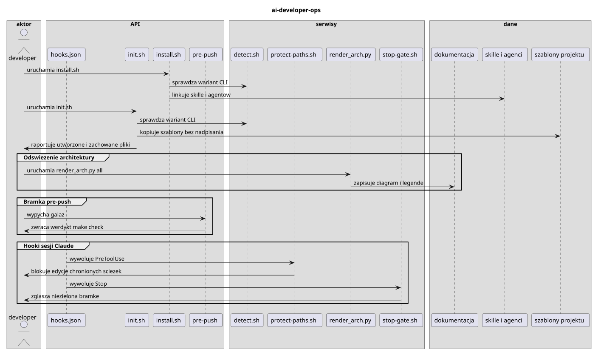

# Architektura ai-developer-ops

## Legenda uczestników

- **developer** — wejście użytkownika
- **hooks.json** — `hooks/hooks.json`
- **init.sh** — `scripts/init.sh`
- **install.sh** — `scripts/install.sh`
- **pre-push** — `.githooks/pre-push`
- **detect.sh** — `scripts/detect.sh`
- **protect-paths.sh** — `scripts/protect-paths.sh`
- **render_arch.py** — `scripts/render_arch.py`
- **stop-gate.sh** — `scripts/stop-gate.sh`
- **dokumentacja** — `docs`
- **skille i agenci** — `skills`
- **szablony projektu** — `templates`

## Ostatnia aktualizacja

- Data: 2026-10-28
- Zakres: odswiezenie po zmianie ops-discover
- Commit: `28a5cd1`
